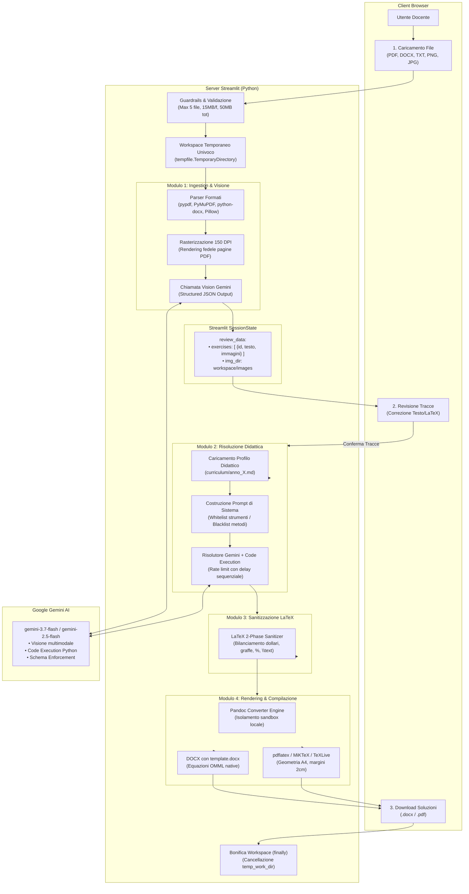

# Architettura Funzionale e Tecnica — CorrettoreAutomatico

> **Documento di Riferimento Architetturale**  
> *Versione:* 2.0  
> *Ultimo aggiornamento:* 26 Agosto 2026  
> *Stato:* Ufficiale e Normativo

---

## 1. Panoramica e Visione Funzionale

**CorrettoreAutomatico** è una piattaforma server-side privata progettata per assistere docenti di Matematica e Fisica della scuola secondaria e media nella risoluzione, formattazione e composizione di compiti, verifiche e quesiti d'esame.

Il sistema elabora documenti cartacei scansionati, compiti manoscritti o file digitali (fino a 10 quesiti per sessione), identifica e separa i singoli esercizi preservando figure e diagrammi, consente al docente di revisionare interattivamente le tracce (*Human-in-the-Loop*) e produce elaborati finali in **DOCX nativo con equazioni OMML modificabili** e **PDF tipografici ad alta leggibilità**.

```
 +-----------------------------------------------------------------------------------+
 |                             PIPELINE END-TO-END                                   |
 |                                                                                   |
 |  [1. Ingestion & Visione] ➔ [2. Revisione Tracce] ➔ [3. Risoluzione & Esportazione] |
 +-----------------------------------------------------------------------------------+
```

---

## 2. Viaggio del Dato End-to-End (Data Journey)

Il diagramma seguente illustra il ciclo di vita delle informazioni, dal caricamento iniziale da parte dell'utente fino al download dei documenti generati e alla bonifica automatica del workspace.



---

## 3. Mappa dei Servizi, Sistemi e Tecnologie

| Layer / Componente | Tecnologia / Libreria | Ruolo Architetturale e Responsabilità |
| :--- | :--- | :--- |
| **Interfaccia Utente & Sessione** | `Streamlit` (>= 1.36.0) | Rendering web reattivo, gestione dello stato (`st.session_state`), UI pastello responsive per desktop e mobile, upload drag-and-drop. |
| **AI Gateway & LLM** | `google-genai` SDK (`gemini-3.7-flash`) | Modello primario multimodale per: <br>1. Trascrizione ed estrazione esercizi con schema JSON;<br>2. Risoluzione passo-passo conforme ai programmi scolastici con verifica numerica (*Code Execution*). |
| **Ingestion Documentale** | `pypdf` (>= 6.0.0) & `python-docx` | Estrazione di testi lineari e immagini raster incorporate da PDF e file DOCX di partenza. |
| **Rasterizzazione Ottica (OCR)** | `PyMuPDF` (`fitz` >= 1.24.4) | Rasterizzazione ad alta risoluzione (150 DPI) delle pagine PDF per consentire a Gemini l'analisi visiva di formule complesse e manoscritti. |
| **Elaborazione Immagini** | `Pillow` (>= 10.4.0) | Validazione dimensioni, conversione formati, controllo limiti megapixel (max 20 MP/immagine). |
| **Motore Didattico Curricolare** | Profili Markdown (`curriculum/*.md`) | Specifiche ministeriali italiane (Scuola Media, 1°-5° Superiore) con *whitelist* di strumenti didattici ammessi e *blacklist* di tecniche universitarie vietate (es. Taylor, integrali multipli, operatori differenziali). |
| **Sanitizzatore LaTeX (2-Fasi)** | Modulo Regex & AST interno | Correzione automatica e robusta di graffe sbilanciate, dollari spaiati, percentuali fuori math-mode e comandi MathJax incompatibili con TeX standard. |
| **Document Converter Engine** | `pypandoc` / `Pandoc` (>= 1.13) | Conversione del Markdown arricchito in DOCX (tramite `template.docx` con OMML nativo) e in PDF tipografico. |
| **Backend TeX / PDF** | `pdflatex` (`MiKTeX` / `TeXLive`) | Compilazione tipografica PDF con pacchetti `amsmath`, `amsfonts`, `graphicx`, `geometry` (margini 2 cm A4). |
| **Isolamento Workspace** | `tempfile.TemporaryDirectory` | Isolamento di sicurezza a livello di sessione/job su filesystem. Bonifica immediata alla conclusione del download. |

---

## 4. Architettura dei Moduli Software

```text
CorrettoreAutomatico/
├── .github/
│   └── workflows/
│       └── deploy.yml         # CI/CD automatica per deploy continuo via SSH su VPS Aruba
├── app.py                     # Entrypoint applicativo, orchestrazione e UI Streamlit
├── curriculum/                # Regole e vincoli ministeriali per anno scolastico
│   ├── scuola_media.md        # Profilo Secondaria di I Grado
│   ├── anno_1.md              # Profilo 1° Anno Superiore (Algebra base, Meccanica base)
│   ├── anno_2.md              # Profilo 2° Anno Superiore (Geometria analitica, Termologia)
│   ├── anno_3.md              # Profilo 3° Anno Superiore (Goniometria, Vettori, Dinamica)
│   ├── anno_4.md              # Profilo 4° Anno Superiore (Trigonometria, Elettromagnetismo)
│   └── anno_5.md              # Profilo 5° Anno Superiore (Analisi Matematica, Fisica Moderna)
├── template.docx              # Reference document Pandoc per esportazione DOCX
├── requirements.txt           # Dipendenze Python bloccate
├── packages.txt               # Pacchetti di sistema (Pandoc, TeX) per cloud deployment
├── Dockerfile                 # Configurazione container per deployment isolato (Render.com)
├── render.yaml                # Dichiarazione infrastruttura Infrastructure-as-Code
├── ARCHITECTURE.md            # Questo documento architetturale
├── GEMINI.md                  # Specifica normativa per coding agent
├── MEMORY.md                  # Registro dello stato operativo e gate di rilascio
└── scratch/                   # Suite di test, validatori e verifiche LaTeX
    └── test_latex_compilation.py  # Test suite per i 10 scenari ostili di compilazione LaTeX
```

---

## 5. Dettaglio dei Moduli Funzionali

### Modulo 1: Ingestion, Validazione e Visione
1. **Accettazione e Guardrails**:
   * Controllo sul tipo MIME reale e firma del file (non solo estensione).
   * Limiti: max 5 file, max 15 MB per singolo file, max 50 MB totali, max 20 pagine per PDF.
2. **Estrazione e Rasterizzazione**:
   * Estrazione del testo editabile da DOCX e PDF.
   * Estrazione delle immagini raster incorporate.
   * Render multimodale a 150 DPI per ogni pagina PDF tramite PyMuPDF (`fitz`), garantendo l'acquisizione di equazioni e diagrammi manoscritti.
3. **Identificazione Esercizi via Gemini**:
   * Invio combinato di testo e canvas visivi a `gemini-3.7-flash`.
   * Enforcing dello schema JSON tipizzato:
     ```json
     {
       "esercizi": [
         {
           "id": 1,
           "testo": "Testo dell'esercizio con formule in LaTeX $...$",
           "immagini_correlate": ["img_1.png"]
         }
       ]
     }
     ```

### Modulo 2: Revisione Tracce (Human-in-the-Loop)
* Interfaccia a schede che consente al docente di:
  * Ispezionare le figure correlate estratte;
  * Correggere o integrare il testo e le formule LaTeX;
  * Visualizzare l'anteprima matematica in tempo reale (*Live KaTeX rendering*).

### Modulo 3: Risoluzione Didattica, Vincoli Negativi & Scaffolding Progressivo
* Caricamento del file `curriculum/anno_X.md` corrispondente alla classe selezionata.
* Generazione del prompt didattico con:
  * **Tipologia e Contenuti del Documento (Configurabili nella Sidebar Sinistra)**:
    * *Documento con Teoria e Spiegazioni* (Nuovo): Compendio didattico completo comprendente:
      1. `Inquadramento Teorico e Prerequisiti`: richiamo esplicito di definizioni, leggi fisiche o teoremi matematici, condizioni di validità e formule notevoli;
      2. `Soluzione e Commento Didattico`: risoluzione passo-passo che connette ogni passaggio algebrico al principio teorico corrispondente;
      3. `Considerazioni Critiche e Conclusioni`: interpretazione fisica o geometrica nel piano cartesiano e verifica dimensionale del risultato.
    * *Documento di Apprendimento (Suggerimenti + Soluzione)*: Sequenza di 3 suggerimenti progressivi di chiarezza crescente sulla prima pagina, seguiti da un'interruzione di pagina (`<!-- PAGE_BREAK -->`) e dalla soluzione estesa su una seconda pagina distinta.
      1. `Suggerimento 1 (Orientamento concettuale e strategia)`: inquadramento qualitativo senza formule risolutive o numeri;
      2. `Suggerimento 2 (Modello e relazioni chiave)`: formalizzazione delle leggi fisiche/geometriche e impostazione del sistema;
      3. `Suggerimento 3 (Passaggio di sblocco operativo)`: indicazione tecnica sul passaggio critico (es. sostituzione, identità algebrica).
    * *Documento di Apprendimento (Solo suggerimenti)*: I 3 suggerimenti progressivi seguiti esclusivamente dal risultato numerico/simbolico finale di verifica per l'autonomia dello studente (senza svolgimento esteso).
    * *Solo soluzione diretta*: Risoluzione didattica completa passo-passo senza teoria preliminare o suggerimenti intermedi.
  * **Whitelist**: Metodi didattici ammessi per l'anno di corso selezionato.
  * **Blacklist (Vincoli Negativi)**: Blocco esplicito di tecniche universitarie non ancora introdotte (es. no derivate in 1°-4° anno, no sviluppi di Taylor $>1$, no integrali multipli).
  * **Code Execution**: Risoluzione numerica verificata tramite interprete Python interno di Gemini per evitare allucinazioni aritmetiche.
  * **Rate Limiting**: Delay di 6.0s sequenziale tra le chiamate per garantire stabilità contro errori HTTP 429.

### Modulo 4: Sanitizzazione LaTeX a 2-Fasi
Prima del passaggio a Pandoc, il testo subisce una sanificazione strutturale per prevenire crash del compilatore TeX:
* **Fase 1 (Pre-Parsing)**: Bilanciamento di delimitatori `$` spaiati, escape del simbolo percentuale `%` fuori da math mode, rimozione di `\cdot` impropri dentro `\text{...}`, correzione di parentesi `\left` / `\right` non accoppiate.
* **Fase 2 (Strutturale TeX)**: Bilanciamento e chiusura di graffe `{...}` orfane, rimozione di radici vuote `\sqrt{ }`, isolamento comandi matematici non delimitati.

### Modulo 5: Compilazione ed Esportazione Artefatti
* **Gestione Universale Interruzioni di Pagina (`<!-- PAGE_BREAK -->`)**:
  * In modalità *Sia soluzione che suggerimenti*, il sistema inserisce programmaticamente un page-break tra testo+indizi e la soluzione, oltre a separare gli esercizi consecutivi:
    * Per **DOCX**: Traduzione in blocco nativo OpenXML ````{=openxml}<w:p><w:r><w:br w:type="page"/></w:r></w:p>````, garantendo che Word crei una reale interruzione di pagina senza alterare l'XML.
    * Per **PDF**: Traduzione nel comando LaTeX `\newpage`, garantendo che `pdflatex` spezzi le pagine in modo pulito con margini coerenti.
* **Sanificazione Caratteri per pdflatex**: pdflatex non supporta caratteri Unicode a 4 byte (emoji come 💡, 🔍, 🎯); il compilatore le filtra in modo mirato solo per il target PDF preservando formule e caratteri matematici, mentre l'esportazione DOCX le mantiene intatte a colori.
* **Esportazione DOCX**: Pandoc converte il Markdown in documento Word nativo, iniettando gli stili da `template.docx` e traducendo il LaTeX in equazioni modificabili **OMML (Office Math Markup Language)**.
* **Esportazione PDF**: Pandoc invoca `pdflatex` con impostazioni di geometria (`geometry:margin=2cm`), generando un documento con impaginazione tipografica professionale in formato A4.
* **Anteprima Interattiva**: L'interfaccia Streamlit consente l'ispezione immediata delle soluzioni e dei suggerimenti generati tramite componenti ad espansione (`st.expander`).

---

## 6. Sicurezza, Privacy e Zero Retention

1. **Gestione dei Segreti**: Nessuna chiave API salvata su file versionati (`api_key.txt` eliminato). Caricamento unicamente da `st.secrets` o variabile d'ambiente `GEMINI_API_KEY`.
2. **Isolamento Workspace**: Ogni job crea una directory temporanea univoca (`correttore_work_XXXXXX`).
3. **Zero Retention**: Tutti i file intermedi e le immagini estratte vengono eliminati in un blocco `finally` o alla rigenerazione della sessione.
4. **Protezione da Prompt Injection**: I documenti degli studenti sono considerati dati non attendibili e incapsulati in blocchi delimitati; il sistema istruisce l'LLM a ignorare comandi di sistema contenuti nei compiti.

---

## 7. Regola di Manutenzione e Governance Architetturale

> **REGOLA VINCOLANTE PER CODING AGENT E SVILUPPATORI (MANDATORY RULE):**
> 
> Questo documento (`ARCHITECTURE.md`) è la **fonte di verità architetturale e funzionale** del progetto.
> 
> In seguito a **qualsiasi modifica impattante**, inclusi:
> 1. Modifiche al flusso dei dati o alle fasi della pipeline;
> 2. Aggiunta, rimozione o sostituzione di servizi AI, librerie o tool di sistema;
> 3. Modifiche ai contratti di input/output (schemi JSON, formati esportati, template);
> 4. Cambiamenti alle policy di sicurezza, ai guardrails di sessione o all'isolamento del filesystem;
> 5. Ristrutturazione modulare del codice (`correttore/*.py` o `app.py`);
> 
> **È OBBLIGATORIO aggiornare contestualmente questo file (`ARCHITECTURE.md`) e registrare il nuovo stato in `MEMORY.md`.**  
> Nessuna pull request, refactor o feature può essere considerata conclusa (*Definition of Done*) se questo documento non riflette fedelmente lo stato reale del software.
